# my-component

<!-- Auto Generated Below -->

## Dependencies

### Depends on

- [localmind-splash](../localmind-splash)
- [localmind-attachment-overlay](../localmind-attachment-overlay)
- [localmind-sidebar](../localmind-sidebar)
- [localmind-temp-conv-card](../localmind-temp-conv-card)
- [localmind-message](../localmind-message)
- [localmind-request-spinner](../localmind-request-spinner)
- [localmind-composer](../localmind-composer)
- [localmind-listen-card](../localmind-listen-card)
- [localmind-models](../localmind-models)

### Graph

```mermaid
graph TD;
  localmind-app --> localmind-splash
  localmind-app --> localmind-attachment-overlay
  localmind-app --> localmind-sidebar
  localmind-app --> localmind-temp-conv-card
  localmind-app --> localmind-message
  localmind-app --> localmind-request-spinner
  localmind-app --> localmind-composer
  localmind-app --> localmind-listen-card
  localmind-app --> localmind-models
  localmind-sidebar --> localmind-history
  localmind-sidebar --> localmind-ollama-status
  localmind-sidebar --> localmind-settings
  localmind-sidebar --> localmind-about-modal
  localmind-history --> localmind-rename-modal
  localmind-history --> localmind-delete-modal
  localmind-settings --> localmind-setting-tab
  localmind-settings --> localmind-settings-general
  localmind-settings --> localmind-settings-model
  localmind-settings --> localmind-settings-appearance
  localmind-settings --> localmind-settings-memories
  localmind-settings --> localmind-settings-tts
  localmind-message --> localmind-map
  localmind-message --> localmind-message-actions
  localmind-message-actions --> localmind-message-stats
  localmind-message-actions --> localmind-message-share-card
  localmind-composer --> localmind-welcome
  localmind-composer --> localmind-attached-files
  style localmind-app fill:#f9f,stroke:#333,stroke-width:4px
```

----------------------------------------------

*Built with [StencilJS](https://stenciljs.com/)*
