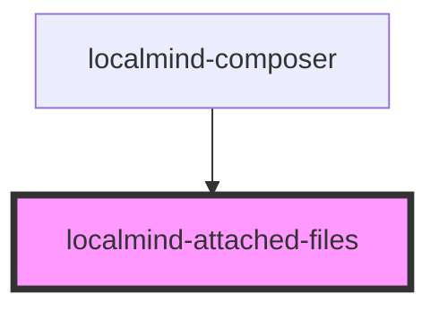

# localmind-attached-files

<!-- Auto Generated Below -->

## Properties

| Property             | Attribute | Description | Type     | Default     |
| -------------------- | --------- | ----------- | -------- | ----------- |
| `files` _(required)_ | --        |             | `File[]` | `undefined` |

## Events

| Event             | Description | Type                |
| ----------------- | ----------- | ------------------- |
| `removeFileEvent` |             | `CustomEvent<File>` |

## Dependencies

### Used by

 - [localmind-composer](../localmind-composer)

### Graph

----------------------------------------------

*Built with [StencilJS](https://stenciljs.com/)*
