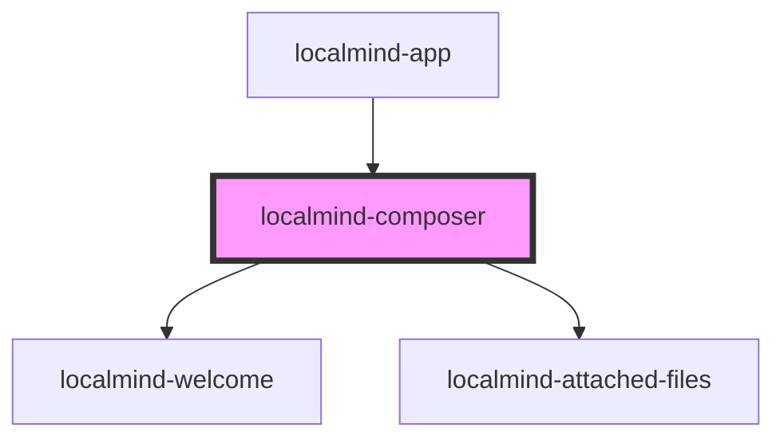

# localmind-composer

<!-- Auto Generated Below -->

## Properties

| Property                        | Attribute            | Description | Type                                   | Default     |
| ------------------------------- | -------------------- | ----------- | -------------------------------------- | ----------- |
| `chatHistory` _(required)_      | --                   |             | `Message[]`                            | `undefined` |
| `isWritingAnswer` _(required)_  | `is-writing-answer`  |             | `boolean`                              | `undefined` |
| `models` _(required)_           | --                   |             | `OllamaModel[]`                        | `undefined` |
| `ollamaRunning`                 | `ollama-running`     |             | `boolean`                              | `undefined` |
| `requestIsPending` _(required)_ | `request-is-pending` |             | `boolean`                              | `undefined` |
| `selectedModel` _(required)_    | --                   |             | `OllamaModel`                          | `undefined` |
| `thinkingLevel`                 | `thinking-level`     |             | `"high" \| "low" \| "medium" \| "off"` | `'off'`     |

## Events

| Event                   | Description | Type                                                |
| ----------------------- | ----------- | --------------------------------------------------- |
| `cancelGenerationEvent` |             | `CustomEvent<void>`                                 |
| `modelSelectedEvent`    |             | `CustomEvent<OllamaModel>`                          |
| `promptEvent`           |             | `CustomEvent<{ text: string; files: File[]; }>`     |
| `thinkLevelEvent`       |             | `CustomEvent<"high" \| "low" \| "medium" \| "off">` |
| `webSearchToggleEvent`  |             | `CustomEvent<boolean>`                              |

## Dependencies

### Used by

 - [localmind-app](../localmind-app)

### Depends on

- [localmind-welcome](../localmind-welcome)
- [localmind-attached-files](../localmind-attached-files)

### Graph

----------------------------------------------

*Built with [StencilJS](https://stenciljs.com/)*
