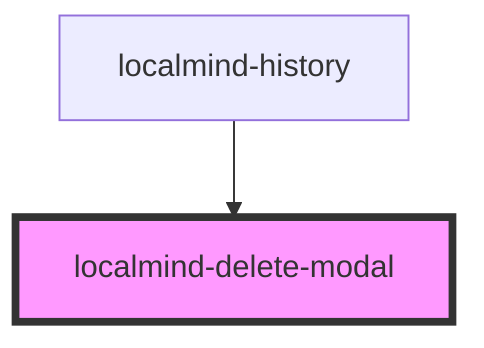

# localmind-delete-modal

<!-- Auto Generated Below -->

## Properties

| Property | Attribute | Description | Type      | Default |
| -------- | --------- | ----------- | --------- | ------- |
| `open`   | `open`    |             | `boolean` | `false` |

## Events

| Event           | Description | Type                  |
| --------------- | ----------- | --------------------- |
| `deleteConfirm` |             | `CustomEvent<string>` |

## Methods

### `hide() => Promise<void>`

#### Returns

Type: `Promise<void>`

### `show(id: string, name: string) => Promise<void>`

#### Parameters

| Name   | Type     | Description |
| ------ | -------- | ----------- |
| `id`   | `string` |             |
| `name` | `string` |             |

#### Returns

Type: `Promise<void>`

## Dependencies

### Used by

 - [localmind-history](../localmind-history)

### Graph

----------------------------------------------

*Built with [StencilJS](https://stenciljs.com/)*
