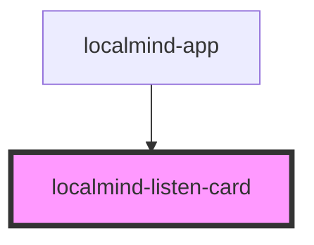

# localmind-listen-card

<!-- Auto Generated Below -->

## Properties

| Property  | Attribute | Description | Type      | Default     |
| --------- | --------- | ----------- | --------- | ----------- |
| `content` | `content` |             | `string`  | `''`        |
| `open`    | `open`    |             | `boolean` | `undefined` |

## Methods

### `hide() => Promise<void>`

#### Returns

Type: `Promise<void>`

### `show(text?: string) => Promise<void>`

#### Parameters

| Name   | Type     | Description |
| ------ | -------- | ----------- |
| `text` | `string` |             |

#### Returns

Type: `Promise<void>`

## Dependencies

### Used by

 - [localmind-app](../localmind-app)

### Graph

----------------------------------------------

*Built with [StencilJS](https://stenciljs.com/)*
