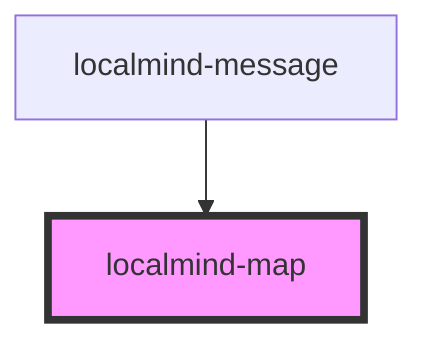

# local-map-widget

<!-- Auto Generated Below -->

## Properties

| Property               | Attribute | Description | Type            | Default     |
| ---------------------- | --------- | ----------- | --------------- | ----------- |
| `mapData` _(required)_ | --        |             | `MapWidgetData` | `undefined` |

## Dependencies

### Used by

 - [localmind-message](../localmind-message)

### Graph

----------------------------------------------

*Built with [StencilJS](https://stenciljs.com/)*
