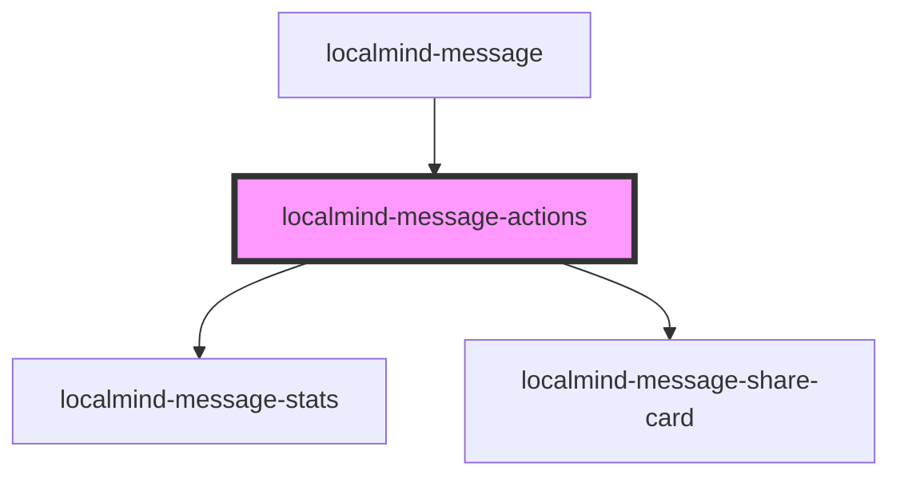

# localmind-message-actions

<!-- Auto Generated Below -->

## Properties

| Property        | Attribute         | Description | Type      | Default     |
| --------------- | ----------------- | ----------- | --------- | ----------- |
| `isLastMessage` | `is-last-message` |             | `boolean` | `undefined` |
| `message`       | --                |             | `Message` | `undefined` |
| `visible`       | `visible`         |             | `boolean` | `undefined` |

## Events

| Event                  | Description | Type                             |
| ---------------------- | ----------- | -------------------------------- |
| `listenRequestedEvent` |             | `CustomEvent<{ text: string; }>` |
| `retryRequestedEvent`  |             | `CustomEvent<string>`            |

## Dependencies

### Used by

 - [localmind-message](../localmind-message)

### Depends on

- [localmind-message-stats](../localmind-message-stats)
- [localmind-message-share-card](../localmind-message-share-card)

### Graph

----------------------------------------------

*Built with [StencilJS](https://stenciljs.com/)*
