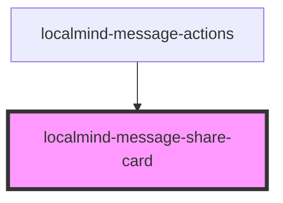

# localmind-message-share-card

<!-- Auto Generated Below -->

## Properties

| Property               | Attribute | Description | Type      | Default     |
| ---------------------- | --------- | ----------- | --------- | ----------- |
| `message` _(required)_ | --        |             | `Message` | `undefined` |
| `open`                 | `open`    |             | `boolean` | `false`     |

## Events

| Event    | Description | Type                |
| -------- | ----------- | ------------------- |
| `closed` |             | `CustomEvent<void>` |

## Methods

### `hide() => Promise<void>`

#### Returns

Type: `Promise<void>`

### `show() => Promise<void>`

#### Returns

Type: `Promise<void>`

## Dependencies

### Used by

 - [localmind-message-actions](../localmind-message-actions)

### Graph

----------------------------------------------

*Built with [StencilJS](https://stenciljs.com/)*
