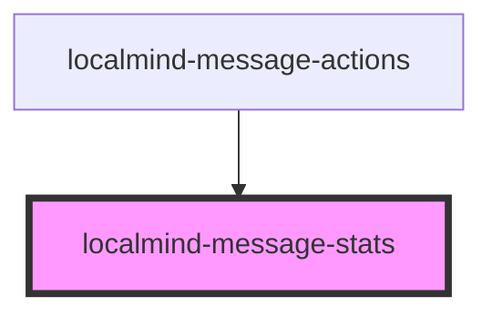

# localmind-message-stats

<!-- Auto Generated Below -->

## Properties

| Property               | Attribute | Description | Type      | Default     |
| ---------------------- | --------- | ----------- | --------- | ----------- |
| `message` _(required)_ | --        |             | `Message` | `undefined` |

## Dependencies

### Used by

 - [localmind-message-actions](../localmind-message-actions)

### Graph

----------------------------------------------

*Built with [StencilJS](https://stenciljs.com/)*
