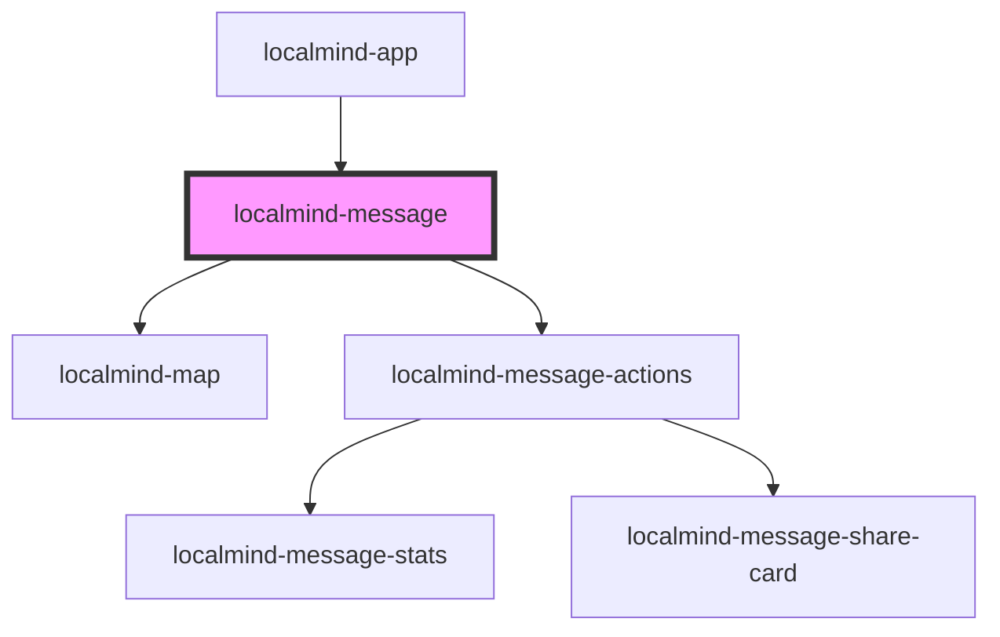

# localmind-message

<!-- Auto Generated Below -->

## Properties

| Property                       | Attribute           | Description | Type      | Default     |
| ------------------------------ | ------------------- | ----------- | --------- | ----------- |
| `isLastMessage` _(required)_   | `is-last-message`   |             | `boolean` | `undefined` |
| `isWritingAnswer` _(required)_ | `is-writing-answer` |             | `boolean` | `undefined` |
| `message` _(required)_         | --                  |             | `Message` | `undefined` |

## Dependencies

### Used by

 - [localmind-app](../localmind-app)

### Depends on

- [localmind-map](../localmind-map)
- [localmind-message-actions](../localmind-message-actions)

### Graph

----------------------------------------------

*Built with [StencilJS](https://stenciljs.com/)*
