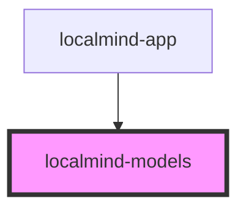

# localmind-models

<!-- Auto Generated Below -->

## Properties

| Property | Attribute | Description | Type            | Default |
| -------- | --------- | ----------- | --------------- | ------- |
| `models` | --        |             | `OllamaModel[]` | `[]`    |
| `open`   | `open`    |             | `boolean`       | `false` |

## Events

| Event                | Description | Type               |
| -------------------- | ----------- | ------------------ |
| `modelsUpdatedEvent` |             | `CustomEvent<any>` |

## Methods

### `hide() => Promise<void>`

#### Returns

Type: `Promise<void>`

### `show() => Promise<void>`

#### Returns

Type: `Promise<void>`

## Dependencies

### Used by

 - [localmind-app](../localmind-app)

### Graph

----------------------------------------------

*Built with [StencilJS](https://stenciljs.com/)*
