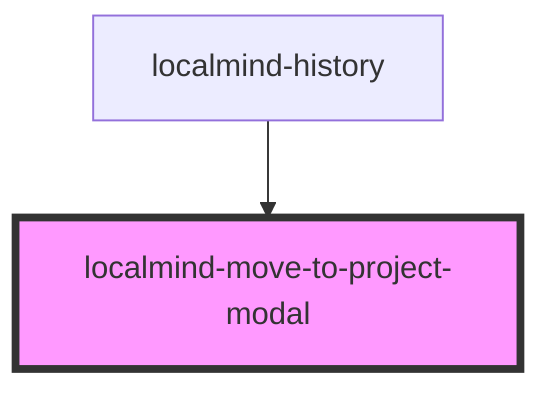

# localmind-move-to-project-modal

<!-- Auto Generated Below -->

## Properties

| Property | Attribute | Description | Type      | Default |
| -------- | --------- | ----------- | --------- | ------- |
| `open`   | `open`    |             | `boolean` | `false` |

## Events

| Event                  | Description | Type                                                          |
| ---------------------- | ----------- | ------------------------------------------------------------- |
| `moveToProjectConfirm` |             | `CustomEvent<{ conversationId: string; projectId: string; }>` |

## Methods

### `hide() => Promise<void>`

#### Returns

Type: `Promise<void>`

### `show(conversationId: string) => Promise<void>`

#### Parameters

| Name             | Type     | Description |
| ---------------- | -------- | ----------- |
| `conversationId` | `string` |             |

#### Returns

Type: `Promise<void>`

## Dependencies

### Used by

 - [localmind-history](../localmind-history)

### Graph

----------------------------------------------

*Built with [StencilJS](https://stenciljs.com/)*
