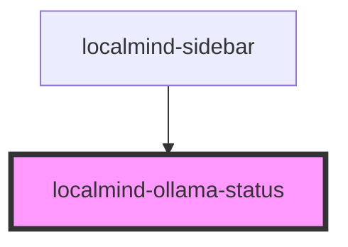

# localmind-ollama-status

<!-- Auto Generated Below -->

## Properties

| Property                     | Attribute        | Description | Type      | Default     |
| ---------------------------- | ---------------- | ----------- | --------- | ----------- |
| `ollamaRunning` _(required)_ | `ollama-running` |             | `boolean` | `undefined` |

## Dependencies

### Used by

 - [localmind-sidebar](../localmind-sidebar)

### Graph

----------------------------------------------

*Built with [StencilJS](https://stenciljs.com/)*
