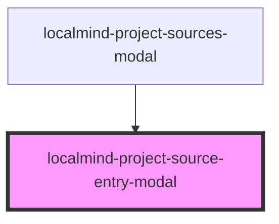

# localmind-project-source-entry-modal

<!-- Auto Generated Below -->

## Properties

| Property | Attribute | Description | Type               | Default  |
| -------- | --------- | ----------- | ------------------ | -------- |
| `mode`   | `mode`    |             | `"link" \| "text"` | `'link'` |
| `open`   | `open`    |             | `boolean`          | `false`  |

## Methods

### `hide() => Promise<void>`

#### Returns

Type: `Promise<void>`

### `show(mode: SourceEntryMode) => Promise<void>`

#### Parameters

| Name   | Type               | Description |
| ------ | ------------------ | ----------- |
| `mode` | `"link" \| "text"` |             |

#### Returns

Type: `Promise<void>`

## Dependencies

### Used by

 - [localmind-project-sources-modal](../localmind-project-sources-modal)

### Graph

----------------------------------------------

*Built with [StencilJS](https://stenciljs.com/)*
