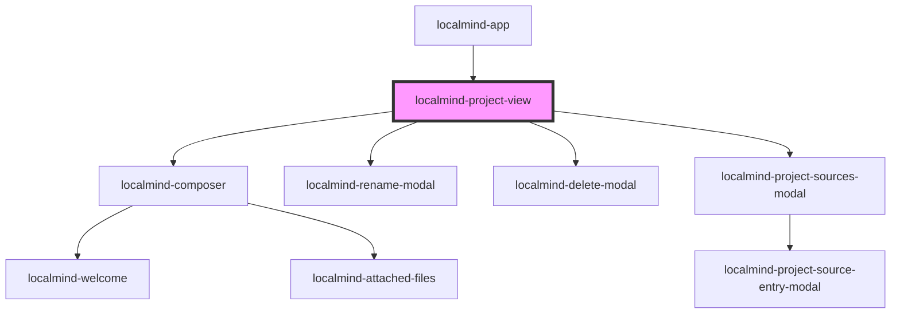

# localmind-project-view

<!-- Auto Generated Below -->

## Properties

| Property                        | Attribute            | Description | Type                                   | Default     |
| ------------------------------- | -------------------- | ----------- | -------------------------------------- | ----------- |
| `isWritingAnswer` _(required)_  | `is-writing-answer`  |             | `boolean`                              | `undefined` |
| `models` _(required)_           | --                   |             | `OllamaModel[]`                        | `undefined` |
| `ollamaRunning` _(required)_    | `ollama-running`     |             | `boolean`                              | `undefined` |
| `requestIsPending` _(required)_ | `request-is-pending` |             | `boolean`                              | `undefined` |
| `selectedModel` _(required)_    | --                   |             | `OllamaModel`                          | `undefined` |
| `thinkingLevel`                 | `thinking-level`     |             | `"high" \| "low" \| "medium" \| "off"` | `'off'`     |

## Events

| Event                     | Description | Type                |
| ------------------------- | ----------- | ------------------- |
| `conversationChangeEvent` |             | `CustomEvent<void>` |

## Dependencies

### Used by

 - [localmind-app](../localmind-app)

### Depends on

- [localmind-composer](../localmind-composer)
- [localmind-rename-modal](../localmind-rename-modal)
- [localmind-delete-modal](../localmind-delete-modal)
- [localmind-project-sources-modal](../localmind-project-sources-modal)

### Graph

----------------------------------------------

*Built with [StencilJS](https://stenciljs.com/)*
