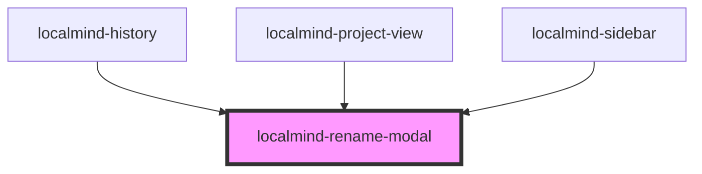

# localmind-rename-modal

<!-- Auto Generated Below -->

## Properties

| Property     | Attribute     | Description | Type                          | Default          |
| ------------ | ------------- | ----------- | ----------------------------- | ---------------- |
| `entityType` | `entity-type` |             | `"conversation" \| "project"` | `'conversation'` |
| `open`       | `open`        |             | `boolean`                     | `false`          |

## Events

| Event                  | Description | Type                                            |
| ---------------------- | ----------- | ----------------------------------------------- |
| `projectRenameConfirm` |             | `CustomEvent<{ id: string; newName: string; }>` |
| `renameConfirm`        |             | `CustomEvent<{ id: string; newName: string; }>` |

## Methods

### `hide() => Promise<void>`

#### Returns

Type: `Promise<void>`

### `show(id: string, currentName: string) => Promise<void>`

#### Parameters

| Name          | Type     | Description |
| ------------- | -------- | ----------- |
| `id`          | `string` |             |
| `currentName` | `string` |             |

#### Returns

Type: `Promise<void>`

## Dependencies

### Used by

 - [localmind-history](../localmind-history)
 - [localmind-project-view](../localmind-project-view)
 - [localmind-sidebar](../localmind-sidebar)

### Graph

----------------------------------------------

*Built with [StencilJS](https://stenciljs.com/)*
