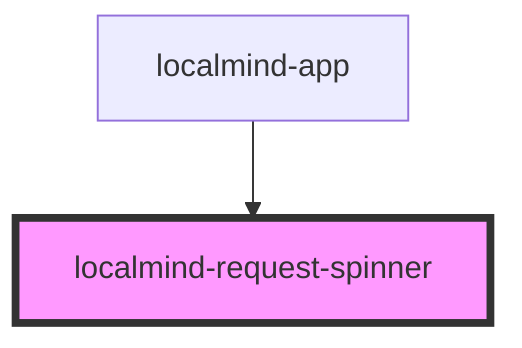

# localmind-request-spinner

<!-- Auto Generated Below -->

## Properties

| Property           | Attribute            | Description | Type      | Default     |
| ------------------ | -------------------- | ----------- | --------- | ----------- |
| `requestIsPending` | `request-is-pending` |             | `boolean` | `undefined` |

## Dependencies

### Used by

 - [localmind-app](../localmind-app)

### Graph

----------------------------------------------

*Built with [StencilJS](https://stenciljs.com/)*
