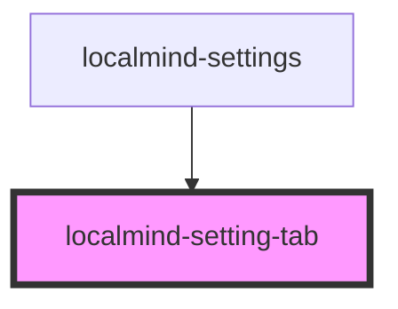

# localmind-setting-tab

<!-- Auto Generated Below -->

## Properties

| Property                | Attribute   | Description | Type      | Default     |
| ----------------------- | ----------- | ----------- | --------- | ----------- |
| `active`                | `active`    |             | `boolean` | `false`     |
| `icon` _(required)_     | `icon`      |             | `string`  | `undefined` |
| `subtitle` _(required)_ | `subtitle`  |             | `string`  | `undefined` |
| `tabId` _(required)_    | `tab-id`    |             | `string`  | `undefined` |
| `tabTitle` _(required)_ | `tab-title` |             | `string`  | `undefined` |

## Dependencies

### Used by

 - [localmind-settings](..)

### Graph

----------------------------------------------

*Built with [StencilJS](https://stenciljs.com/)*
