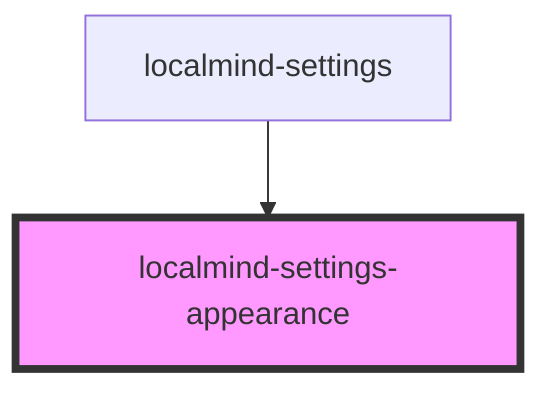

# localmind-settings-appearance

<!-- Auto Generated Below -->

## Methods

### `commitCurrentValues() => Promise<Partial<LocalMindSettings>>`

#### Returns

Type: `Promise<Partial<LocalMindSettings>>`

## Dependencies

### Used by

 - [localmind-settings](..)

### Graph

----------------------------------------------

*Built with [StencilJS](https://stenciljs.com/)*
