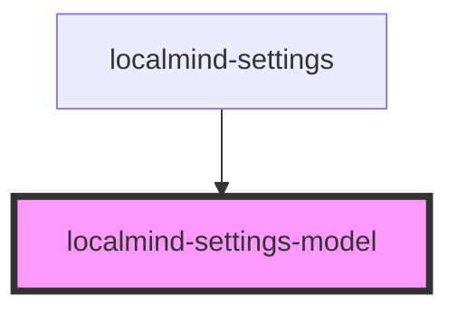

# localmind-settings-model

<!-- Auto Generated Below -->

## Properties

| Property                     | Attribute        | Description | Type      | Default     |
| ---------------------------- | ---------------- | ----------- | --------- | ----------- |
| `models` _(required)_        | --               |             | `any[]`   | `undefined` |
| `ollamaRunning` _(required)_ | `ollama-running` |             | `boolean` | `undefined` |

## Methods

### `commitCurrentValues() => Promise<Partial<LocalMindSettings>>`

#### Returns

Type: `Promise<Partial<LocalMindSettings>>`

## Dependencies

### Used by

 - [localmind-settings](..)

### Graph

----------------------------------------------

*Built with [StencilJS](https://stenciljs.com/)*
