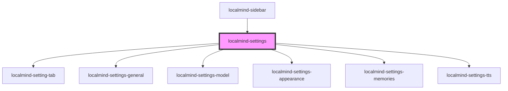

# localmind-settings

<!-- Auto Generated Below -->

## Properties

| Property                     | Attribute        | Description | Type      | Default     |
| ---------------------------- | ---------------- | ----------- | --------- | ----------- |
| `models` _(required)_        | --               |             | `any[]`   | `undefined` |
| `ollamaRunning` _(required)_ | `ollama-running` |             | `boolean` | `undefined` |
| `open`                       | `open`           |             | `boolean` | `false`     |

## Methods

### `hide() => Promise<void>`

#### Returns

Type: `Promise<void>`

### `show() => Promise<void>`

#### Returns

Type: `Promise<void>`

## Dependencies

### Used by

 - [localmind-sidebar](../localmind-sidebar)

### Depends on

- [localmind-setting-tab](localmind-setting-tab)
- [localmind-settings-general](localmind-settings-general)
- [localmind-settings-model](localmind-settings-model)
- [localmind-settings-appearance](localmind-settings-appearance)
- [localmind-settings-memories](localmind-settings-memories)
- [localmind-settings-tts](localmind-settings-tts)

### Graph

----------------------------------------------

*Built with [StencilJS](https://stenciljs.com/)*
