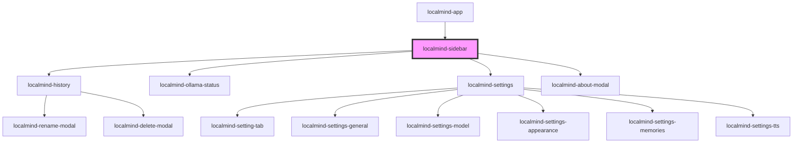

# localmind-sidebar

<!-- Auto Generated Below -->

## Properties

| Property                     | Attribute        | Description | Type      | Default     |
| ---------------------------- | ---------------- | ----------- | --------- | ----------- |
| `collapsed`                  | `collapsed`      |             | `boolean` | `false`     |
| `models` _(required)_        | --               |             | `any[]`   | `undefined` |
| `ollamaRunning` _(required)_ | `ollama-running` |             | `boolean` | `undefined` |

## Events

| Event             | Description | Type                |
| ----------------- | ----------- | ------------------- |
| `modelsCardEvent` |             | `CustomEvent<void>` |
| `newChatEvent`    |             | `CustomEvent<void>` |
| `tempChatEvent`   |             | `CustomEvent<void>` |

## Dependencies

### Used by

 - [localmind-app](../localmind-app)

### Depends on

- [localmind-history](../localmind-history)
- [localmind-ollama-status](../localmind-ollama-status)
- [localmind-settings](../localmind-settings)
- [localmind-about-modal](../localmind-about-modal)

### Graph

----------------------------------------------

*Built with [StencilJS](https://stenciljs.com/)*
