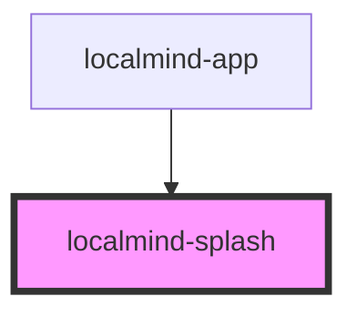

# localmind-splash

<!-- Auto Generated Below -->

## Properties

| Property  | Attribute  | Description | Type      | Default |
| --------- | ---------- | ----------- | --------- | ------- |
| `isReady` | `is-ready` |             | `boolean` | `false` |

## Dependencies

### Used by

 - [localmind-app](../localmind-app)

### Graph

----------------------------------------------

*Built with [StencilJS](https://stenciljs.com/)*
