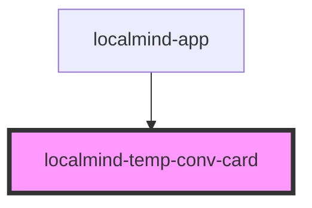

# localmind-temp-conv-card

<!-- Auto Generated Below -->

## Properties

| Property   | Attribute   | Description | Type      | Default |
| ---------- | ----------- | ----------- | --------- | ------- |
| `isActive` | `is-active` |             | `boolean` | `false` |

## Dependencies

### Used by

 - [localmind-app](../localmind-app)

### Graph

----------------------------------------------

*Built with [StencilJS](https://stenciljs.com/)*
