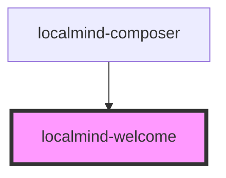

# localmind-welcome

<!-- Auto Generated Below -->

## Properties

| Property        | Attribute | Description | Type        | Default |
| --------------- | --------- | ----------- | ----------- | ------- |
| `attachedFiles` | --        |             | `File[]`    | `[]`    |
| `chatHistory`   | --        |             | `Message[]` | `[]`    |

## Dependencies

### Used by

 - [localmind-composer](../localmind-composer)

### Graph

----------------------------------------------

*Built with [StencilJS](https://stenciljs.com/)*
